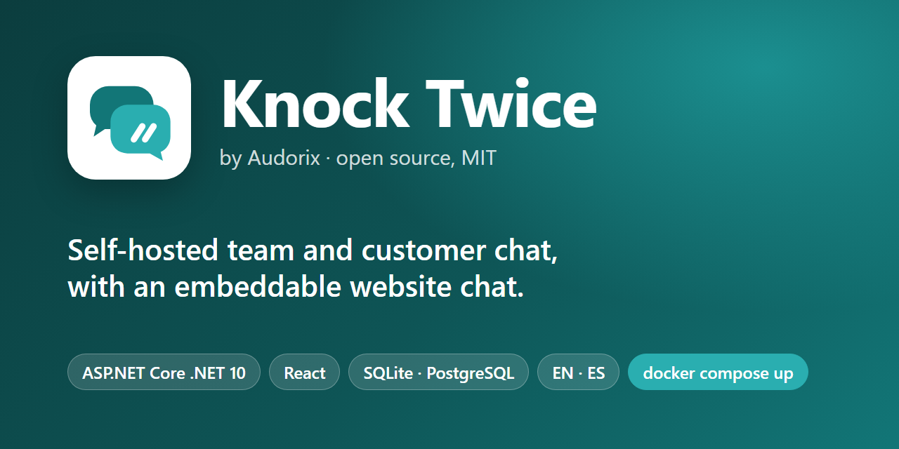

<p align="center">
  
</p>

# Knock Twice

<p align="center">
  <a href="ROADMAP.md"><strong>🗺️ Roadmap</strong></a> ·
  <a href="#features">Features</a> ·
  <a href="#quick-start-with-docker">Quick start</a> ·
  <a href="#get-started">Get started</a> ·
  <a href="#documentation">Documentation</a> ·
  <a href="CHANGELOG.md">Changelog</a>
</p>

<p align="center">
  <a href="https://hub.docker.com/r/ikemyle/knocktwice-api"></a>
  <a href="https://hub.docker.com/r/ikemyle/knocktwice-api"></a>
</p>

**by Audorix.** Open-source, self-hosted team and customer chat built with ASP.NET Core (.NET 10)
and React. One messaging engine serves personal chat, business communication and an embeddable
website chat. Runs on **SQLite** or **PostgreSQL**, in English and Spanish.

The .NET code lives in the **Audorix.KnockTwice** namespaces and projects. Some public names still
carry the original name ChatX, for compatibility with existing installations and embeds: the
`ChatXWidget` JavaScript API, `X-ChatX-*` headers, `CHATX_*` variables and the `Audorix.ChatX.Api.dll`
file. They change in 2.0.

> **Version 1.0.0.** Covered by automated tests on both databases. See the
> [changelog](CHANGELOG.md).

## What's next: the roadmap

The next five planned releases, in order of delivery. Read the full **[roadmap](ROADMAP.md)** for
what each one includes, its release gate, and how to send feedback.

| Release | Focus | What it makes possible |
| :-- | :-- | :-- |
| **1** | [Company setup and access](ROADMAP.md#release-1-company-setup-and-access) | Set up a workspace, control access, and send formatted messages and code snippets. |
| **2** | [Customer support desk](ROADMAP.md#release-2-customer-support-desk) | Turn website conversations into support cases a team can manage together. |
| **3** | [Mobile and shared media](ROADMAP.md#release-3-mobile-and-shared-media) | Keep up with conversations on mobile and find or play shared media in context. |
| **4** | [Partner collaboration and data control](ROADMAP.md#release-4-partner-collaboration-and-data-control) | Work with external partners, connect company drives and business systems, and move or recover conversation data. |
| **5** | [AI for conversations and business teams](ROADMAP.md#release-5-ai-for-conversations-and-business-teams) | Translate messages, turn recordings into searchable notes, and give teams specialized assistants, including a support agent that can work with tickets. |

Have a use case or a gap to report? [Open an issue](https://github.com/Audorix/KnockTwice/issues).

## Features

- **Chat:** direct and group conversations, replies, edits and deletions, delivered/read receipts,
  typing indicators, presence, unread counts and realtime updates (SignalR) across devices.
- **Messages:** reactions, threads, @mentions with an Activity page, pinned and saved messages,
  forwarding, rich text (bold, italic, code, lists, links), drafts, scheduled messages and
  reminders.
- **Files:** images, PDF, Office, text and ZIP attachments.
  - Checked by content and kept private.
  - Stored on disk or in S3-compatible storage.
  - Optional ClamAV scanning.
- **Private chats:** one-to-one chats that live only in server memory for the initiator's session and
  are never saved.
- **Organizations:** members with roles, invitations, workspaces, **channels** (public or private),
  **teams**, **guests** limited to single channels, and organization-specific settings.
- **Website chat:** embed a chat on any website with one script tag or a React component.
  - Visitors can be anonymous or identified by a token your server signs.
  - Members answer in their normal chat.
  - Support agents work an inbox with subjects, assignment, internal notes and open, pending or
    closed status.
- **Profiles:** profile photos and links (website, GitHub, LinkedIn, YouTube, Instagram, X) shown to
  contacts, light and dark themes.
- **Administration:** live settings, email/storage/captcha providers, user and organization
  management, roles (Administrator, Auditor) and an audit log.
- **Accounts:** email confirmation, password reset, revocable sessions, Google/Microsoft sign-in,
  Cloudflare Turnstile, rate limits, CSRF protection, account deletion that keeps conversations
  readable ("Deleted user").
- **Notifications:** email when messages stay unread (batched, daily or off) and browser push while
  Knock Twice is closed, following each person's preview setting.
- **Search:** find messages and file names across your conversations (prefix, accent-blind), with
  filters; database full-text by default, OpenSearch optional.
- **Data retention:** inactive website visitors and never confirmed accounts are removed
  automatically; message retention can be switched on.
- **Operations:**
  - Setup wizard on first start.
  - Health endpoints.
  - Explicit migrations.
  - Docker images on [Docker Hub](https://hub.docker.com/u/ikemyle) and Compose profiles.
  - Optional Redis for running several API instances.

## Quick start with Docker

Try Knock Twice on your own computer with the published images. You need
[Docker Desktop](https://www.docker.com/products/docker-desktop/) (or Docker Engine on Linux) and one file:

1. Download [`compose.quickstart.yaml`](https://raw.githubusercontent.com/Audorix/KnockTwice/master/docker/compose.quickstart.yaml)
   into an empty folder.
2. In that folder, run:

   ```sh
   docker compose -f compose.quickstart.yaml up -d
   ```

3. Open <http://localhost:8080> and follow the setup wizard. The setup code is in the log of the
   `api` container (Docker Desktop: **Containers > knocktwice > api > Logs**). For email, use host
   `mailpit`, port `1025`, security *None*; the emails arrive at <http://localhost:8025>.

Details, stopping and removing: [Quick start with Docker](docs/quick-start-docker.md). For a server,
use the [Docker deployment guide](docs/deployment-docker.md).

## Get started

| You want to… | Read |
| --- | --- |
| Try it on your machine with Docker | [Quick start](docs/quick-start-docker.md): download [`compose.quickstart.yaml`](docker/compose.quickstart.yaml), run `docker compose -f compose.quickstart.yaml up -d`, then open <http://localhost:8080> |
| Run it on a server | [Docker deployment](docs/deployment-docker.md) (PostgreSQL + HTTPS) or [installation without Docker](docs/installation.md) |
| Get the Docker images | [`ikemyle/knocktwice-api`](https://hub.docker.com/r/ikemyle/knocktwice-api) and [`ikemyle/knocktwice-web`](https://hub.docker.com/r/ikemyle/knocktwice-web) on Docker Hub; the [Docker deployment](docs/deployment-docker.md) guide uses them |
| Develop it | [Getting started](docs/development/getting-started.md), [Docker development profiles](docs/development/docker.md) and [contributing](CONTRIBUTING.md) |

Every path starts with the **setup wizard** in the browser. It chooses the database, configures email
and creates the first administrator, after you enter the setup code the server prints
([where to find it](docs/installation.md#finding-the-setup-code)).

## Embed the website chat

```html
<script src="https://chat.example.org/widget.js" data-widget-id="YOUR-WIDGET-ID" async></script>
```

A complete example with server-signed identities is in
[examples/website-chat](examples/website-chat). The React component is in
[web/packages/chat-embed](web/packages/chat-embed).

## Documentation

| Topic | Document |
| --- | --- |
| Installation, upgrades, administrators | [installation.md](docs/installation.md) |
| Quick start on your computer (Docker) | [quick-start-docker.md](docs/quick-start-docker.md) |
| Docker deployment | [deployment-docker.md](docs/deployment-docker.md) |
| Backup and restore (with a restore drill) | [backup-restore.md](docs/backup-restore.md) |
| Database migrations | [database-migrations.md](docs/database-migrations.md) |
| Configuration reference | [development/configuration.md](docs/development/configuration.md) |
| API (guide + OpenAPI reference) | [api/README.md](docs/api/README.md) · [openapi-v1.json](docs/api/openapi-v1.json) |
| Architecture | [ARCHITECTURE.md](docs/ARCHITECTURE.md) · [solution boundaries](docs/development/architecture-boundaries.md) |
| Architecture decisions | [ADR.md](docs/ADR.md) |
| **Product roadmap** (next five releases) | [ROADMAP.md](ROADMAP.md) |
| Development history (phases) | [IMPLEMENTATION.md](docs/IMPLEMENTATION.md) · delivery records in [docs/releases](docs/releases) (release 0.1.0: [Phase 12](docs/releases/phase-12-open-source-release.md); next: [Phase 13](docs/releases/phase-13-hardening.md), [Phase 14](docs/releases/phase-14-search.md), [Phase 15](docs/releases/phase-15-notifications.md), [Phase 16](docs/releases/phase-16-reactions-threads.md), [Phase 17](docs/releases/phase-17-mentions.md), [Phase 18](docs/releases/phase-18-message-tools.md), [Phase 19](docs/releases/phase-19-rich-text.md), [Phase 20](docs/releases/phase-20-planning.md), [Phase 21](docs/releases/phase-21-release-readiness.md), [Phase 22](docs/releases/phase-22-performance.md), [Phase 23](docs/releases/phase-23-send-path.md), [Phase 24](docs/releases/phase-24-throughput.md), [UI redesign](docs/releases/ui-redesign.md); release 1.0.0: everything above) |
| Testing | [development/testing.md](docs/development/testing.md) |
| Third-party licenses | [third-party-licenses.md](docs/third-party-licenses.md) |

## Repository layout

```text
src/Api/Audorix.KnockTwice.Api                       HTTP host, setup wizard, migrate/grant-role commands
src/Core/Audorix.KnockTwice.Domain                   entities and invariants
src/Core/Audorix.KnockTwice.Application              use cases and ports
src/Core/Audorix.KnockTwice.Contracts                wire DTOs and error codes
src/Infrastructure/Audorix.KnockTwice.Infrastructure EF Core model, Identity, email, storage adapters
src/Infrastructure/Audorix.KnockTwice.Persistence.*  SQLite and PostgreSQL adapters with migrations
tests/                                          unit, architecture and integration tests
web/apps/chat-web                               React web app, embedded chat page, widget loader
web/packages/chat-embed                         React integration for the website chat
examples/website-chat                           example website with server-signed identities
docker/                                         Dockerfiles, nginx config, Compose profiles
scripts/                                        validation, migrations, license report, restore drill
docs/                                           guides, reference, ADRs, release records
```

## Contributing and security

Contributions are welcome. See [CONTRIBUTING.md](CONTRIBUTING.md).

Please report vulnerabilities privately as described in [SECURITY.md](SECURITY.md), not in public
issues.

## License

[MIT](LICENSE) © 2026 Audorix. Third-party components are listed in
[docs/third-party-licenses.md](docs/third-party-licenses.md).
