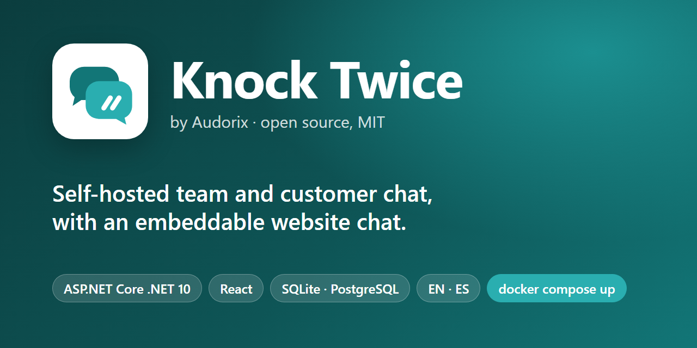

# Knock Twice web app

The web front end for **Knock Twice by Audorix**: open-source, self-hosted team and customer chat. This image is nginx serving the React web app, the embeddable website-chat page and its loader. It forwards `/api`, `/hubs` (realtime, WebSocket) and `/health` to the API. MIT licensed.

It needs the API image [`ikemyle/knocktwice-api`](https://hub.docker.com/r/ikemyle/knocktwice-api), reachable as the service `api`. Start them together with Docker Compose, not with `docker run` or the Docker Desktop **Run** button: Knock Twice needs several containers working together.

## Quick start: try it on your computer

You need Docker (Docker Desktop on Windows or Mac) and one file. Nothing is built, and there is no password or settings file to prepare.

1. Download [`compose.quickstart.yaml`](https://raw.githubusercontent.com/Audorix/KnockTwice/master/docker/compose.quickstart.yaml) into an empty folder.
2. In that folder, run:

   ```sh
   docker compose -f compose.quickstart.yaml up -d
   ```

3. Open http://localhost:8080 and follow the setup wizard. The setup code is in the log of the `api` container (Docker Desktop: **Containers > knocktwice > api > Logs**). For email, use host `mailpit`, port `1025`, security *None*; the emails arrive at http://localhost:8025.

This uses SQLite and is reachable only from your computer. Step-by-step guide: [Quick start with Docker](https://github.com/Audorix/KnockTwice/blob/master/docs/quick-start-docker.md)

### Port already in use?

The quick start uses port `8080` (web app) and `8025` (email inbox). Choose others with `KNOCKTWICE_PORT` and `KNOCKTWICE_MAIL_PORT` when you start it, for example:

```sh
# PowerShell
$env:KNOCKTWICE_MAIL_PORT = "8026"; docker compose -f compose.quickstart.yaml up -d
# Linux or Mac
KNOCKTWICE_MAIL_PORT=8026 docker compose -f compose.quickstart.yaml up -d
```

The wizard's email settings stay host `mailpit`, port `1025`. If you change the web port, enter the new address as the wizard's **Web app address**. Details: [If a port is already in use](https://github.com/Audorix/KnockTwice/blob/master/docs/quick-start-docker.md#if-a-port-is-already-in-use)

## Run it on a server

For a server use the production Compose file from the source repository (PostgreSQL, HTTPS behind a reverse proxy):

```sh
git clone https://github.com/Audorix/KnockTwice.git
cd KnockTwice
# follow docs/deployment-docker.md to create docker/.env.production and the database password file
docker compose -f docker/compose.production.yaml --env-file docker/.env.production pull
docker compose -f docker/compose.production.yaml --env-file docker/.env.production up -d
```

The production Compose file publishes the web port on `127.0.0.1:8080` only. Put a TLS reverse proxy (Caddy, nginx, Traefik…) in front of it, because sign-in cookies require HTTPS.

Full guide: [Deploying with Docker](https://github.com/Audorix/KnockTwice/blob/master/docs/deployment-docker.md)

## About the image

- Based on `nginxinc/nginx-unprivileged`; listens on port `8080` as a non-root user.
- Health check: `/health/live` (through to the API).

## Tags

- `1.1.0`: release 1.1.0
- `latest`: the newest release

Use the same version for the API and web images.

## Links

- Source and issues: https://github.com/Audorix/KnockTwice
- Changelog: https://github.com/Audorix/KnockTwice/blob/master/CHANGELOG.md
