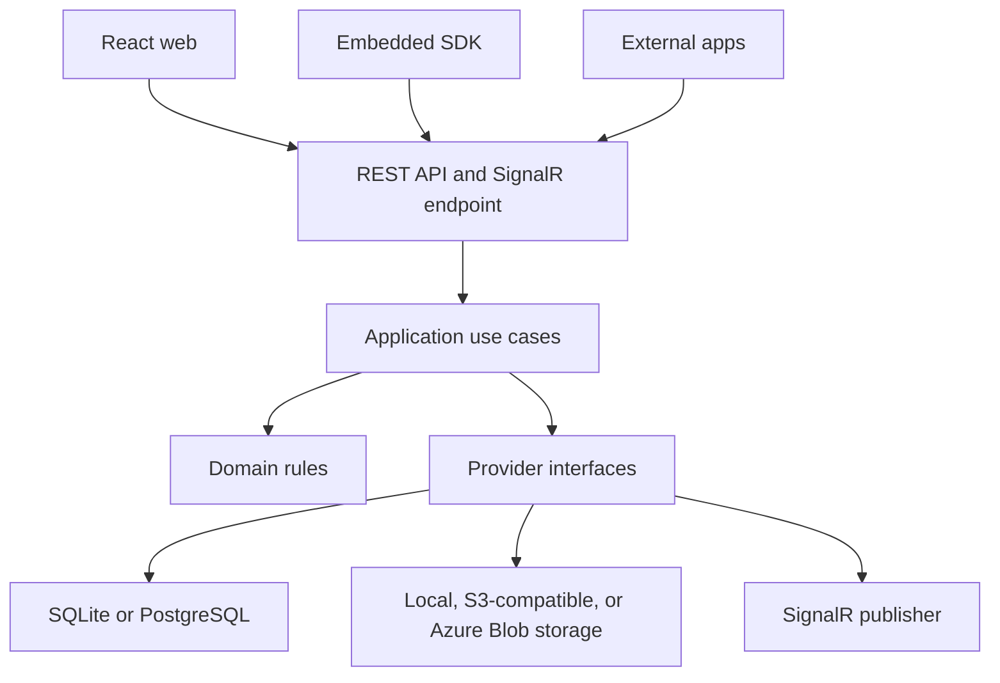

# Knock Twice — System Architecture

> **Source and revision policy.** Prepared from the user-supplied `Pasted markdown(4).md`, which contains the ChatX documentation draft. The unavailable shared link was not used as evidence. Source technology choices and feature intent are retained. “Accepted” and “Approved” labels in that draft are not treated as evidence of separate user approval. New implementation recommendations below are proposals, not previously agreed requirements. These documents describe intended behavior; they do not certify implemented or tested software.

**Companion documents:** [ADR](ADR.md) · [Architecture](ARCHITECTURE.md) · [Implementation](IMPLEMENTATION.md).

**Document:** ARCHITECTURE.md\
**Version:** 1.1 — documentation revision, 2026-11-22\
**Status:** Design draft derived from supplied conversation

## 1. Overview

Knock Twice is an open-source, configurable communication platform built on .NET 10 and React.

The platform provides three primary experiences:

1. General-purpose messaging.
2. Business communication.
3. Embeddable website and application chat.

All experiences share the same application services, persistence model, messaging engine and security infrastructure.

## 2. System architecture

### 2.1 High-level architecture



## 3. Backend architecture

### 3.1 Solution organization

| Directory / project | Responsibility |
| --- | --- |
| `src/Api/Audorix.KnockTwice.Api` | HTTP and SignalR endpoints; composition root |
| `src/Core/Audorix.KnockTwice.Domain` | Entities, value objects and business rules |
| `src/Core/Audorix.KnockTwice.Application` | Use cases and provider ports |
| `src/Core/Audorix.KnockTwice.Contracts` | Public DTOs and event envelopes |
| `src/Infrastructure/Audorix.KnockTwice.Infrastructure` | EF mappings and initial adapters |
| `src/Infrastructure/Audorix.KnockTwice.Persistence.Sqlite` | SQLite configuration and migrations |
| `src/Infrastructure/Audorix.KnockTwice.Persistence.PostgreSql` | PostgreSQL configuration and migrations |
| Logical module folders | Identity, Users, Organizations, Contacts, Conversations, Messaging, Presence, Notifications, Attachments, Widgets |
| Optional later adapter projects | `Audorix.KnockTwice.Realtime.SignalR`, `Audorix.KnockTwice.Storage.Local`, `Audorix.KnockTwice.Storage.S3` |
| Shared localization resources | Initially in the host/application; extract `Audorix.KnockTwice.Localization` only when reused |

The initial implementation should not create unnecessary assemblies. Closely related modules may initially live within the same project, provided their logical boundaries remain clear.

### 3.2 Dependency rules

Domain:

- Contains entities, value objects and domain rules.
- Does not reference infrastructure.
- Does not reference EF Core.
- Does not reference SignalR.

Application:

- Contains use cases and application services.
- Defines provider interfaces.
- Coordinates domain operations.

Infrastructure:

- Implements provider interfaces.
- Contains EF Core configurations.
- Implements storage and realtime integrations.

API:

- Composition root.
- Authentication and authorization configuration.
- Endpoint registration.
- Middleware.
- OpenAPI.

## 4. Frontend architecture

### 4.1 Project structure

| Directory | Package or purpose |
| --- | --- |
| `web/apps/chat-web` | First-party chat and initial admin routes |
| `web/apps/admin` | Optional later independent administration app |
| `web/packages/chat-core` | `@audorix/chatx-core` |
| `web/packages/chat-ui` | `@audorix/chatx-ui` |
| `web/packages/chat-sdk` | `@audorix/chatx` |
| `web/packages/chat-embed` | `@audorix/chatx-embed` |
| `web/packages/api-client` | `@audorix/chatx-api-client` |
| `web/packages/realtime` | `@audorix/chatx-realtime` |
| `web/packages/localization` | `@audorix/chatx-localization` |
| `web/packages/theme` | `@audorix/chatx-theme` |

These are logical boundaries. Create packages when their implementation phase needs them, rather than generating empty packages in Phase 1.

npm scope: `@audorix`. Public SDK package: `@audorix/chatx`.

Other packages use names such as `@audorix/chatx-ui` and `@audorix/chatx-embed`; `@audorix/chatx` is a complete package name, not a nested npm scope.

### 4.2 Responsibilities

| **Package**  | **Responsibility**                       |
| ------------ | ---------------------------------------- |
| chat-core    | Messaging state and application logic    |
| chat-ui      | Reusable React components                |
| chat-sdk     | Public JavaScript/TypeScript integration |
| chat-embed   | Website widget                           |
| api-client   | REST communication                       |
| realtime     | SignalR client                           |
| localization | Language resources                       |
| theme        | Visual customization                     |

The embedded widget should be isolated from the host website's CSS. Shadow DOM is a suitable default, with iframe isolation available where stronger isolation is required.

## 5. Domain architecture

### 5.1 Identity and users

Entities:

- User
- UserProfile
- UserPreference
- ExternalLogin
- Role
- Permission
- UserRole

ASP.NET Core Identity handles credential and account management.

### 5.2 Organizations

Entities:

- Organization
- OrganizationMember
- OrganizationRole
- Workspace
- WorkspaceMember
- Team
- TeamMember

Organization membership and personal contacts are independent relationships.

### 5.3 Conversations

Entities:

- Conversation
- ConversationParticipant
- ConversationSettings
- ConversationReadState

Conversation types:

```csharp
public enum ConversationType
{
    Direct = 1,
    Group = 2,
    Channel = 3,
    Support = 4
}
```

All conversation types use the shared messaging engine.

### 5.4 Messaging

Entities:

- Message
- MessageAttachment
- MessageReceipt
- MessageReaction (reserved for a later extension; not an MVP table requirement).

Message types:

- Text.
- System.
- Image.
- File.
- Future extensible types.

Messages support editing, deletion, replies, receipts and attachments.

Message content must be validated according to its type.

### 5.5 Embedded chat

Entities:

- Widget
- WidgetDomain
- Visitor
- VisitorSession
- VisitorIdentity

Widget ownership is associated with an organization or installation.

Visitor sessions must be isolated from ordinary registered-user authentication.

## 6. Data ownership and multi-tenancy

The initial deployment uses shared database infrastructure.

Organization-owned resources must contain explicit ownership information.

Every request must resolve its authorized organization context from trusted server-side authentication and membership information.

Never rely solely on a client-provided organization identifier.

The system must distinguish:

- Installation-level data.
- Organization-owned data.
- Workspace-owned data.
- User-owned data.
- Visitor-owned data.

Cross-organization access must be denied unless an explicitly authorized sharing mechanism is implemented.

## 7. Database architecture

### 7.1 EF Core

Use a shared logical data model.

Provider implementations:

- SQLite.
- PostgreSQL.

Each provider has its own migrations.

Recommended indexes:

- Conversation participants by user and conversation.
- Messages by conversation, creation timestamp and ID.
- Message receipts by message and participant.
- Organization memberships by organization and user.
- Workspace memberships by workspace and user.
- Notifications by user and creation timestamp.

Use appropriate unique constraints for memberships, idempotency identifiers and relationships.

Avoid provider-specific behavior leaking into application services.

### 7.2 Message storage

Messages are persisted in the relational database.

Message history uses cursor pagination.

Large attachments are stored outside the relational database.

### 7.3 Transactional outbox

A message transaction must persist:

1. Message.
2. Idempotency record.
3. Outbox event.

A background dispatcher publishes the event.

Failed publication must be retried.

Event processing must be idempotent.

### 7.4 Support routing queue providers

Support conversations and visitor messages remain persisted in the relational database. A queue
provider transports routing work; it does not own or replace case history.

- Define an application-owned queue contract so routing and assignment rules do not depend on a
  broker SDK.
- `Database` is the default provider. It stores durable, leased work items in the configured
  SQLite or PostgreSQL database and supports retry after worker restart.
- `Redis` is an optional provider, implemented with Redis Streams and consumer groups so work can be
  acknowledged after processing and recovered after consumer failure.
- Write a routing outbox record in the same transaction that creates or updates the case. When Redis
  is selected, publish from that outbox and mark delivery only after Redis accepts the item; consumers
  use a stable work-item ID to make retries idempotent.
- Apply bounded retries, visibility leases, and observable failed-item handling. Do not silently
  drop a case when a broker is unavailable.
- Keep future Azure Service Bus and RabbitMQ integrations as adapters to the same queue contract.

Configuration uses `SupportQueue:Provider` with `Database` as the default and `Redis` as the other
initial option. Selecting an unavailable or unknown provider must fail startup with a clear error.

## 8. Realtime architecture

SignalR is the initial transport.

Application services publish application events through `IRealtimePublisher`.

SignalR groups represent authorized realtime destinations, not independent security boundaries.

Every connection and group membership must be authorized.

Initial events:

```text
MessageCreated
MessageUpdated
MessageDeleted
MessageDelivered
MessageRead
UserPresenceChanged
TypingStatusChanged
ConversationUpdated
NotificationReceived
```

Typing events are ephemeral and should not be persisted.

Presence is calculated from active connections and session policies.

Multiple simultaneous connections per user are supported.

For multi-instance deployments, use a supported distributed SignalR scale-out mechanism and distributed presence coordination.

## 9. Storage architecture

Storage providers:

- Local filesystem.
- S3-compatible object storage.
- Azure Blob Storage.

Database records contain:

- File ID.
- Owner.
- Storage key.
- Original filename.
- MIME type.
- Size.
- Creation timestamp.
- Associated message or conversation.

Use generated storage keys instead of trusting user filenames.

Uploads must undergo:

- Extension validation.
- MIME validation.
- File signature checks.
- Size validation.
- Authorization checks.
- Malware scanning integration where configured.

Downloads must be authorized through the associated conversation or resource.

## 10. Authentication and authorization

Authentication:

- ASP.NET Core Identity.
- Email/password.
- External OAuth/OIDC providers.
- Secure session management.

Authorization:

- Policy-based.
- Resource-aware.
- Organization-aware.
- Workspace-aware.

Role vocabulary across the roadmap includes (activate each role only when its module is delivered):

- Installation Administrator.
- Organization Administrator.
- Workspace Administrator.
- Team Manager.
- Member.
- Guest.
- Support Agent.

Roles are collections of permissions, not substitutes for resource-level authorization.

The permission catalog spans five capability areas: private-chat use; organization-scoped support;
organization participation and management; organization/workspace-scoped channel creation and
administration; and installation administration for users, roles, permissions, groups, settings,
providers, organizations, and audit. Assignments may be scoped to installation, organization, or
workspace. Users receive granular custom roles through groups; direct custom-role-to-user
assignments are not supported. Each role/permission pair is Allow, Deny, or unassigned. A Deny
from any applicable role overrides every Allow, including a built-in role grant. Conversation,
organization, workspace, and participant checks still determine which records they may access.
Installation administration never grants access to private conversation content by itself.

The effective-access view must explain the source of each decision (group, role, and Allow/Deny),
and permission changes must be auditable and effective on the next request. User-interface
visibility follows the effective permissions, but API and realtime authorization remain
authoritative.

For browser applications, prefer secure HttpOnly cookies with appropriate CSRF protection where using cookie authentication. External SDK authentication uses short-lived, narrowly scoped tokens.

## 11. Localization

Initial languages:

- English.
- Spanish.

Frontend:

- i18next.
- Translation resources.
- Language detection.
- Locale-aware formatting.

Backend:

- ASP.NET Core Localization.
- Resource files.
- Localized validation.
- Localized notifications.

Separate UI language, notification language and message language.

All user-facing strings must be externalized.

## 12. API architecture

Base URL:

```text
/api/v1/
```

Initial endpoint groups:

```text
auth/
users/
contacts/
organizations/
workspaces/
conversations/
messages/
attachments/
notifications/
widgets/
```

REST handles:

- Authentication operations.
- CRUD operations.
- Message persistence.
- Message history.
- Configuration.
- Administrative operations.

SignalR handles realtime delivery and ephemeral events.

Use explicit request/response contracts. Do not expose EF Core entities directly.

## 13. Security architecture

Requirements:

- HTTPS.
- Authentication.
- Authorization.
- Tenant isolation.
- Rate limiting.
- Input validation.
- Secure session management.
- CSRF protection where applicable.
- Secure upload processing.
- Origin restrictions for widgets.
- Content Security Policy.
- Audit logging.
- Secrets outside source control.
- Dependency security review.

Message rendering must prevent HTML and script injection.

The widget must not trust metadata supplied by the host website without validating its authenticity.

## 14. Deployment architecture

Support:

- Local development.
- Self-hosted Docker deployment.
- SaaS deployment.

Recommended production configuration:

A reverse proxy terminates HTTPS and forwards HTTP and WebSocket traffic to the API host. The host accesses PostgreSQL and private attachment storage (S3-compatible or Azure Blob). Its initial background services dispatch the transactional outbox and expire presence sessions. Redis or another distributed realtime service is added only when scale-out is implemented and tested.

SQLite and local filesystem are available for lightweight installations.

Use environment-specific configuration and persistent storage.

Do not require cloud-specific services.

## 15. Scalability strategy

Initial deployment:

- One application instance.
- One database.
- One storage provider.
- SignalR.

Future deployment:

- Multiple API instances.
- Distributed realtime infrastructure.
- Distributed presence.
- Shared object storage.
- Background worker scaling.
- Event dispatch coordination.

Avoid process-local state for information that must survive restarts or be shared between instances.

## 16. Future extension points

The architecture should accommodate:

- Voice messages.
- Audio and video calls.
- Message reactions.
- Polls.
- Channels.
- Customer support workflows.
- Bots.
- Webhooks.
- AI assistants.
- Message translation.
- Search.
- Advanced analytics.
- Retention policies.
- Enterprise SSO.

These features are not part of the initial implementation unless explicitly added to the roadmap.

## 17. Proposed implementation detail

This section elaborates the draft and the proposed ADRs. It is design guidance, not evidence that these contracts already exist. Ownership and ordering alternatives must be settled before their migrations are committed.

### 17.1 Dependency and transaction boundaries

Domain references no framework adapters. Application references Domain and explicit contracts. Infrastructure implements application ports. Api composes Application and Infrastructure. Contracts contain wire types without EF entities. Module code accesses other modules through application contracts, not arbitrary table mutation.

Start with Api, Domain, Application, Contracts, Infrastructure and separate provider migration projects. Keep module folders inside these projects until an independently consumed component justifies a separate assembly. Use one database transaction for a message, idempotency entry and outbox entry; a generic repository must not split that atomic operation across contexts.

Suggested ports include `IConversationAuthorization`, `IMessageStore`, `IUnitOfWork`, `IRealtimePublisher`, `IAttachmentStore`, `IVisitorTokenService`, `IClock` and an outbound email delivery interface. Identity verification and password reset need a development mail sink and a configured production mail provider. No SMTP or other provider was selected in the source.

### 17.2 Ownership and integrity constraints

| Record | Required invariant |
| --- | --- |
| OrganizationMember | Unique organization/user pair and explicit active/revoked state |
| WorkspaceMember | Workspace belongs to the same organization; organization membership required |
| Conversation | Valid personal or organization scope; workspace, if present, belongs to its organization |
| ConversationParticipant | Unique conversation/principal pair; active status and history-access bounds |
| Message | Conversation, sender, immutable creation time, mutable version; reply targets same conversation |
| MessageAttachment | Ready attachment and message share ownership scope and conversation authorization |
| IdempotencyRecord | Unique actor/scope/operation/key; canonical request hash and response reference |
| OutboxEvent | Stable event ID, payload version, attempt count, availability time and processing lease |
| ConversationReadState | One participant state with nondecreasing delivered/read positions |
| VisitorSession | Widget and organization binding, expiry, revocation and constrained conversation access |

Use database foreign keys and uniqueness constraints where possible, plus application authorization for contextual rules. EF filters are defense in depth; they do not authorize a resource. Background jobs, exports and realtime fan-out must enforce the same ownership rules as HTTP endpoints. Installation administration does not automatically imply unrestricted message-body access.

If ADR-021 is adopted, represent a participant as a validated registered-user or visitor principal with exactly one identity reference. Visitor principals never acquire ordinary organization membership merely by starting a session.

### 17.3 Message write path and retries

1. Authenticate, resolve scope, verify active participation, validate payload and attachments.
2. Begin a transaction and reserve a unique actor/scope/operation/idempotency key.
3. For an existing key, return the original response when the request hash matches; return a conflict when it differs.
4. Persist the message and outbox record, plus sequences/change entry if ADR-022 is accepted, then commit.
5. Return the persisted message and version. Reconcile the client's optimistic message using its request identifier.
6. A dispatcher leases due events, checks authorized recipients, publishes, and records completion. Use bounded retry delays and observable failed-event handling.

Concurrent identical requests must converge through a unique constraint and retry handling. An HTTP timeout after commit must be safely retryable. A crash after publish but before marking the outbox entry complete can cause duplicate publication; clients and consumers must deduplicate. Define idempotency retention before release so guarantees do not silently disappear after cleanup.

### 17.4 History, change feed and receipt contracts

The source baseline uses an opaque timestamp/ID history cursor. If ADR-022 is accepted, use opaque conversation-bound sequence cursors instead. Do not implement both as competing order authorities.

History requests are bounded and return `items`, `nextCursor` and `hasMore`. A proposed `GET /api/v1/conversations/{id}/changes?after=...` returns authorized changes and a resume cursor. Changes include edits and tombstones. An expired cursor returns a stable error code instructing a snapshot refresh. Clients subscribe, buffer live events, retrieve a consistent snapshot/cursor, replay subsequent changes and then apply buffered events with deduplication.

Suggested event fields: `eventId`, `schemaVersion`, `eventType`, `conversationId`, `occurredAtUtc`, `entityId`, `entityVersion`, and typed payload; add `changeSequence` if ADR-022 is accepted. Avoid broadcasting internal ownership or storage details unnecessarily.

The draft's per-message read route may remain as a compatibility facade over participant watermarks. Add an explicit delivery acknowledgement route in Phase 6. A watermark cannot advance beyond an accessible committed message. For removal, move connections out of protected destinations and prevent dispatch to stale membership; authorization at initial Hub connection alone is insufficient. Already transmitted content cannot be recalled.

### 17.5 Attachment lifecycle

Suggested states: `PendingUpload`, `Quarantined`, `Ready`, `Rejected`, `Deleted`. Upload intent binds size/type limits, actor, scope and conversation before accepting bytes. Store under generated private keys. Validate actual byte count, detected type and signature; run configured malware checks before `Ready`.

Only ready attachments can be linked to a message. Clean up expired uploads and orphaned objects idempotently. A storage failure must not leave a message falsely reporting an available attachment. Authorize each download; if signed download URLs are used, keep lifetimes short and document that issued URLs remain usable until expiry. Prevent local path traversal and avoid inline execution of active file types.

### 17.6 Browser and embedded security

Use same-origin first-party web deployment where practical. Validate antiforgery tokens for cookie-authenticated mutations. Validate external-login state, nonce, callback and allowed return URL. Google and Microsoft configuration remain optional; disabled providers do not prevent local login.

Widget public configuration contains no secrets. A host server can exchange a verified external identity for a ChatX visitor session bound to widget, organization, subject, audience, expiry and allowed actions. Do not accept a browser-supplied email as authenticated identity. Domain allowlists use exact normalized origins; a permitted origin does not grant access to another conversation. If using iframe messaging, validate both `event.origin` and sender window and use explicit target origins.

Anonymous visitors require per-widget/session/network rate and storage limits. Do not depend on third-party cookies for widget authentication. Tokens, message bodies and attachment contents must be excluded from routine logs.

### 17.7 Operations and portability

| Concern | Initial design requirement |
| --- | --- |
| Health | Separate liveness from readiness; readiness checks required configured dependencies |
| Migrations | Versioned provider-specific migrations; controlled application before service rollout |
| SQLite | Single-instance lightweight profile; handle write contention and test foreign keys |
| PostgreSQL | Production-oriented profile; exercise real concurrency and unique constraints |
| Backups | Coordinate database and object inventory; prove restore with a disposable installation |
| Secrets | Environment/secret store; masked configuration screens; no secret values in audit events |
| Keys | Persist authentication/data-protection keys across restarts; share securely if scaled out |
| Observability | Request errors, outbox lag/retries, reconnects, upload failures and storage usage |
| Scale-out | Shared storage, realtime backplane, presence coordination and worker leases required together |
| Support routing | Durable database default; optional Redis Streams transport; route work through an outbox and make consumers idempotent |

Keep the outbox worker in the initial host. Process-local presence is acceptable as explicitly ephemeral single-node state; it is not suitable for durable receipts or multi-node coordination. No throughput, availability or scale guarantee is established by this design.
