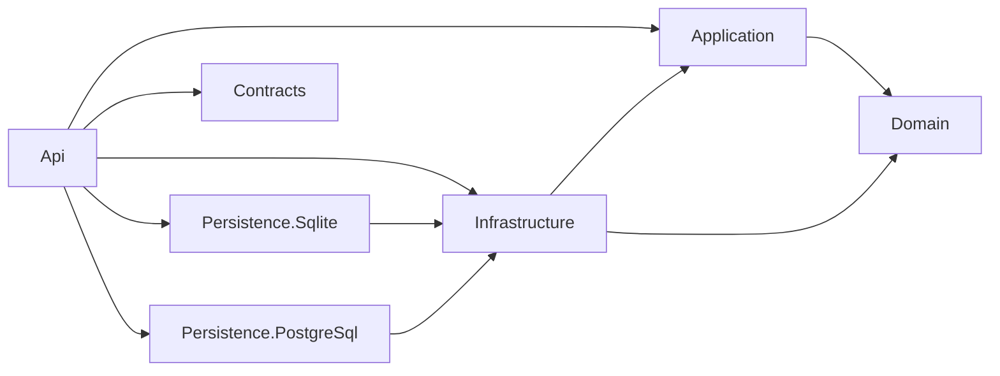

# Solution structure and dependency boundaries

This page describes the **implemented** Phase 1 solution. Direction comes from
[ADR-001/002/004](../ADR.md) and [Architecture §3 and §17.1](../ARCHITECTURE.md).

## Projects

| Project | Path | Responsibility today |
| --- | --- | --- |
| `Audorix.KnockTwice.Domain` | `src/Core/` | Entities and invariants: `Installation`, `UserProfile` (display name, UI language, initials), `UserSession`, role/permission vocabulary, `DomainRuleException`. |
| `Audorix.KnockTwice.Application` | `src/Core/` | Use cases and ports: `AccountService` (registration, confirmation, recovery, password change, external provisioning), `SessionService`, `UserProfileService`, `InstallationService`; ports `IUserAccountManager`, `IUserProfileStore`, `ISessionStore`, `IEmailSender`, `ICaptchaVerifier`; localized account emails. |
| `Audorix.KnockTwice.Contracts` | `src/Core/` | Wire DTOs for meta, health, auth, users and admin; stable `ErrorCodes`. |
| `Audorix.KnockTwice.Infrastructure` | `src/Infrastructure/` | Provider-neutral EF Core model (`ChatXDbContext` incl. ASP.NET Core Identity tables and Data Protection keys), store adapters, `IdentityUserAccountManager`, email adapters (SMTP via MailKit, Postmark via HTTP), captcha adapters (Cloudflare Turnstile, disabled), options validation, readiness check, `DatabaseMigrator`. |
| `Audorix.KnockTwice.Persistence.Sqlite` | `src/Infrastructure/` | SQLite adapter, its migrations and model snapshot, design-time factory. |
| `Audorix.KnockTwice.Persistence.PostgreSql` | `src/Infrastructure/` | PostgreSQL (Npgsql) adapter, its migrations and model snapshot, design-time factory. |
| `Audorix.KnockTwice.Api` | `src/Api/` | Composition root, HTTP pipeline, setup mode and wizard API, health/OpenAPI endpoints, the SignalR hub `/hubs/chat`, problem responses, localization resources, `migrate`/`grant-role` commands. |
| Test projects | `tests/` | `UnitTests`, `ArchitectureTests`, `IntegrationTests` (real SQLite/PostgreSQL). |

## Actual reference graph

- **Domain** and **Contracts** reference nothing (no projects, no packages).
- **Application** references Domain plus only `Microsoft.Extensions.*` abstractions (DI, Options,
  Localization). It knows nothing about ASP.NET Core Identity, EF Core or HTTP; it does not yet
  reference Contracts because the API maps application results to wire DTOs.
- **Infrastructure** references EF Core *Relational*, MailKit, `Microsoft.Extensions.Http`, and
  exactly two ASP.NET Core packages that are EF persistence integrations:
  `Microsoft.AspNetCore.Identity.EntityFrameworkCore` (user/role stores) and
  `Microsoft.AspNetCore.DataProtection.EntityFrameworkCore` (key ring storage). HTTP pipeline types
  (`Http`, `Mvc`, `Routing`, `Authentication`, `Hosting`, `SignalR`) are forbidden by tests.
  Neither SQLite nor Npgsql packages are visible to it.
- **Api** owns everything HTTP-bound: cookie authentication, `SignInManager`, OAuth handlers (Google,
  Microsoft), antiforgery, rate limiting, permission policies and endpoint mapping.
- Each **persistence project** references Infrastructure and exactly one EF provider. They never
  reference each other.
- **Api** is the only project that sees every adapter; `Database:Provider` selects one at runtime.

The graph is enforced by `tests/Audorix.KnockTwice.ArchitectureTests`, which checks both the
declared `ProjectReference`/`PackageReference` items and the references compiled into each
assembly, plus that Contracts types expose only primitives, collections and other contracts.
Adding an edge requires updating that test and this page.

## Modules

Modules live as folders inside these projects (Architecture §3.1); no per-module assemblies.
Implemented so far: `Installations`, `Localization`, `Identity`/`Users`/`Sessions` (Phase 2),
`Organizations` (organizations, memberships, invitations, workspaces) and `Contacts` (contacts,
requests, blocks) in Phase 3, `Realtime` (presence, typing, destinations; Phase 4),
`Conversations` (direct and group conversations, participants, history; Phase 5), `Messaging`
(Phase 6), `Attachments` and `PrivateChats` (Phase 7), `Administration` (Phase 9), `Widgets`
(Phase 10), business communication (Phase 11, see below) and the host-level `Setup` wizard
(`src/Api/.../Setup`). Notifications do not exist yet and have no empty folders.

### Business communication (Phase 11, ADR-026)

- Domain `Organizations/Business.cs`: `Team`, `TeamMember`, `ChannelTeam`, `OrganizationGuest`,
  `GuestInvitation`; `Organization` gains its own settings (`GuestsEnabled`, `ChannelCreation`),
  `OrganizationMember.IsSupportAgent`, `WorkspaceMember.ChangeRole`. Conversations gain
  `ConversationType.Channel` (`WorkspaceId`, `Visibility`, unique `ChannelKey`), support state on
  website conversations (`SupportStatus`, `AssignedToUserId`) and `ConversationParticipant.IsGuest`.
- Application: channels and the support inbox are partials of `ConversationService`
  (`ConversationService.Channels.cs`, `.Support.cs`) because they take sequence numbers and reuse its
  save/notify/revoke helpers; `TeamService` and `GuestService` sit in `Organizations/`. The single
  access rule is `ConversationService.MayUseAsync` (visitor, guest, or member plus workspace), mirrored
  by the two realtime queries in `EfConversationStore`.
- API `Endpoints/BusinessEndpoints.cs`; web `features/business` (channels, channel page, support
  inbox, organization sections).

### Website chat (Phase 10, ADR-024)

- Domain `Widgets/`: `Widget` (exact-origin normalization, enable rules), `WidgetResponder`,
  `Visitor`, `VisitorSession`. Conversations gain `ConversationType.Website`, `Conversation.WidgetId`
  and `ConversationParticipant.IsVisitor` (the only participant that needs no organization membership).
- Application `Widgets/`: `WidgetService` (management, owners/administrators), `VisitorService`
  (sessions, identity, conversation, sending, uploads — always through `ConversationService`,
  `MessagingService` and `AttachmentService` with the visitor's stand-in account),
  `IdentityTokens` (HS256 verification), `VisitorRateLimiter` and the ports `IWidgetStore`,
  `IWidgetSecretProtector` (Data Protection) and `IVisitorAccounts` (Identity stand-in accounts).
- API `Widgets/`: the `Visitor` authentication scheme (bearer session tokens; never a cookie, so the
  `/api/v1/widget` group sits outside the antiforgery-filtered v1 group), `WidgetEndpoints`,
  `WidgetHub` (`/hubs/widget`) and `WidgetConnectionSweeper`. `SignalRRealtimePublisher` sends to
  both hubs, except presence and private-chat events, which never reach visitors.
- Web: `public/widget.js` (loader, no dependencies), `embed.html` + `src/embed` (second Vite page,
  own CSS, no Bootstrap), `features/widgets` (administration) and `web/packages/chat-embed` (React
  package that only drives the loader).

### Attachments and storage (Phase 7, ADR-007)

- Application owns the policy (`AttachmentService`, `FileTypes`) and the ports `IAttachmentStore`
  (EF metadata, same unit of work as conversations), `IAttachmentStorage` (content) and
  `IMalwareScanner`. Infrastructure implements `LocalAttachmentStorage`, `S3AttachmentStorage`
  (plain HTTP with Signature V4 — no cloud SDK dependency) and `ClamAvScanner` in `Storage/`.
- The record is committed as `PendingUpload` before bytes are written; content removal after a
  deletion is tracked (`content_removed`) and retried by `AttachmentCleanupService`, because storage
  and database share no transaction. A composite foreign key `(conversation_id, message_entry_id)`
  keeps an attachment inside its conversation.
- Storage keys are random (`yyyy/MM/<32 hex>`) and validated again by the local provider so no key
  can resolve outside its root.

### Administration (Phase 9)

- Application `Administration/`: `AuditService` (with redaction of sensitive detail names),
  `UserAdministrationService`, `OrganizationAdministrationService` and the ports `IAuditStore`,
  `IAdminDirectory`, `IInstallationSettingsStore`, `IAuditContext`. Organization changes reuse
  `OrganizationService` rules (an organization always keeps an owner).
- The live-settings layer is an API concern (`Api/Administration`): a configuration provider
  inserted after the settings file, loaded and reloaded by `RuntimeSettingsLoader`; services that
  depend on live settings take `IOptionsSnapshot<T>`. Provider settings are validated by building
  a candidate service graph (as the setup wizard does) before the settings file is changed.
- Permissions are checked against the account's current roles in the database on every admin
  request, so role changes apply immediately. No installation role reads conversations.

### Private chats (Phase 7, ADR-025)

- `PrivateChatService` and the singleton `PrivateChatRegistry` live only in memory; nothing goes
  through `IConversationStore`, the outbox or `IAttachmentStorage`. Events go to explicit
  connections (`IRealtimePublisher.PublishToConnectionsAsync`): the initiator's session and the
  invitee. Sign-out and session revocation end the session's chats before closing connections.

### Conversation model (ADR-021, ADR-022)

- `conversations.scope` is `Personal` or `Organization` (check constraint ties it to
  `organization_id`). Access = active participation, plus active organization membership for
  organization conversations, checked server-side on every request and every hub operation.
- History entries take `conversations.last_sequence + 1`; `last_sequence` is an EF concurrency
  token, so concurrent writers conflict and retry instead of sharing a number, and
  `(conversation_id, sequence)` is unique as a backstop. Cursors are opaque wrappers of the
  sequence; unread = others' entries after the participant's read position.
- A participant's history starts at `visible_from_sequence` (their join entry); leaving or removal
  ends access; rejoining reuses the row with a new start. Direct conversations are unique by
  `direct_key` (scope + ordered pair).

### Messaging model (Phase 6, ADR-012, ADR-022, ADR-023)

- Messages are history entries of kind `Message` in `conversation_events`, so they share the
  per-conversation sequence, join-based visibility, pagination and unread counts. Edits and
  deletions change the row in place and increase `version`; deletion keeps a tombstone.
- Idempotency: unique `(conversation_id, actor_user_id, client_message_id)`; a retry returns the
  original. Replies use a composite foreign key `(conversation_id, reply_to_entry_id)` →
  `(conversation_id, id)`, so a reply can never point into another conversation.
- Transactional outbox (`outbox_messages`): every message change writes its outbox row in the same
  `SaveChanges`; after commit the row is published and deleted, otherwise the background
  `OutboxDispatcherService` retries with backoff. Recipients are computed at dispatch time
  (active participants who may see that position, with organization membership), so stale
  membership never receives anything. Delivery is at least once; clients deduplicate by `eventId`
  and keep the highest `version`.
- Receipts: `last_delivered_sequence` / `last_read_sequence` per participant, forward only.

### Setup mode

`ChatXProgram` decides per process start: without `Setup:Completed` it builds a small **setup
host** (no database, Identity, authentication or application endpoints; only health, the setup API
and a `setup_required` answer elsewhere). The wizard's `SetupProvisioner` layers the candidate
settings over the host configuration and builds the *same* core service graph as the real host
(`AddChatXCoreServices`) to validate options, probe the database (`IDatabaseProvider.ProbeAsync`),
run `DatabaseMigrator` and `AccountService.CreateInstallationAdministratorAsync`. Only then does it
write the settings file atomically and restart the process in normal mode.

### Realtime model (ADR-005, Architecture §8)

- Application owns the rules (`RealtimeService`) and the ephemeral, process-local state
  (`RealtimeState`: connections per user, joined conversations, offline grace, typing expiry). Ports:
  `IRealtimePublisher`, `IRealtimeConnections` (implemented with SignalR in Api),
  `IPresenceAudience` (EF query in Infrastructure) and `IConversationAccess`.
- `ChatHub` (`/hubs/chat`) is a thin adapter. `RealtimeHubFilter` re-validates the sign-in session
  on every call and maps application errors to `HubException` codes. Groups are named
  `conversation:{id}` and are delivery destinations, not security boundaries: joining and every
  typing signal re-check `IConversationAccess`; a failed check removes all of the user's
  connections from the destination.
- Presence audience = contacts ∪ people sharing an active direct chat or group (not channels or
  website chats), minus blocks (either direction); Phase 22, ADR-036 (it was everyone sharing an
  active organization). It is symmetric, so it also limits whose presence a user may read.
- Until Phase 5, `NoConversationAccess` denies every conversation in production; the integration
  tests use a protected fixture implementation.

### Phase 3 isolation model (ADR-008, ADR-021)

- Every organization operation first loads the caller's **active** `organization_members` row
  server-side; a client-supplied organization id is never trusted on its own. Non-members get 404,
  so ids from other organizations disclose nothing.
- Workspaces are always loaded by `(organization_id, workspace_id)`. Access needs an active
  workspace membership, or the organization permission to manage workspaces.
- The database backs this up: `workspace_members` has composite foreign keys to
  `workspaces(organization_id, id)` and `organization_members(organization_id, user_id)`, so a
  workspace membership cannot point at another organization's workspace or at a non-member.
- Organization roles (`owner`, `administrator`, `member`) are scoped to a membership and map to
  permissions in Domain code; installation roles (Phase 2) stay in Identity. Workspace roles are
  `administrator` and `member`.
- Contacts are personal: stored as one ordered user pair, independent of organizations. At most one
  pending request per pair is enforced by a filtered unique index; self-contacts and self-blocks
  by check constraints.

## Design choices recorded in Phase 1

| Choice | Reason |
| --- | --- |
| One `ChatXDbContext` in Infrastructure; migrations in each provider project via `MigrationsAssembly` | Shared logical model (ADR-004) with independent provider migrations and snapshots. |
| `IDatabaseProvider` port with two implementations | Lets Infrastructure validate and configure a provider without referencing provider packages. Not a generic repository. |
| Each persistence project is its own design-time startup project | `dotnet ef migrations add` for SQLite never needs PostgreSQL and vice versa; no database is opened. |
| `Installation` foundation record, single row enforced by a unique index + check constraint on a shadow `singleton` column | Proves migrations and CRUD on both providers without speculative chat, tenant or widget tables. Internal only: no endpoint reads or writes it. |
| Explicit snake_case table/column names | Identical, unquoted names on both providers. |
| `DateTimeOffset` for timestamps, always UTC | Maps to `timestamp with time zone` in PostgreSQL. SQLite stores it as text; it cannot be ordered server-side there, which matters for later message history design (see ADR-017/ADR-022). |
| `Guid.CreateVersion7` identifiers | GUID identifiers (ADR-017) that sort roughly by creation time. |
| `TimeProvider` instead of a custom `IClock` | Framework abstraction, overridable in tests. |
| `migrate` command on the API executable | Same image/binary applies migrations as a separate, explicit step. Normal startup never calls `EnsureCreated`; it migrates only with `Database:MigrateOnStartup` (on in Development since Phase 5, after a missed `migrate` broke a local run), and otherwise logs pending migrations. |
| Vite proxy (dev) and nginx (Docker) for API access | Same-origin in both cases, so the API configures **no CORS at all**. |
| Microsoft.Testing.Platform runner (`global.json`) with xUnit v3 | Required by the xUnit v3 releases used on the .NET 10 SDK. |
| *Phase 2:* HttpOnly cookie + antiforgery for the web app (Architecture §10) | Tokens are never readable by JavaScript; widget/SDK tokens remain a Phase 10 decision (ADR-024 stays Proposed). |
| *Phase 2:* server-side `user_sessions` referenced by a `chatx:sid` claim | Real revocation (sign out other devices, password reset ends all sessions) without a ticket store or JWT. |
| *Phase 2:* `IEmailSender` with `Smtp` (default, local) and `Postmark` adapters | Provider choice by configuration, as requested; no SDK — Postmark is called over HTTP. |
| *Phase 2:* `ICaptchaVerifier` with `Turnstile` (default) and `None` | Provider choice by configuration; fails closed when Cloudflare is unreachable. |
| *Phase 2:* no enumeration in register / resend / forgot-password; uniform `invalid_credentials` incl. lock-out | Avoids revealing which addresses have accounts. |
| *Phase 2:* external sign-in never auto-links an existing local account by email | Prevents account takeover through a provider. |
| *Phase 2:* generated initials avatars | Image upload depends on the Phase 7 storage abstraction and its file validation. |
| *Phase 2:* roles stored with Identity; permissions mapped in Domain code | Only `InstallationAdministrator` is active (Architecture §10: activate roles with their modules). |
| *Phase 2:* account emails use the profile's UI language | ADR-009 separates notification language; a distinct preference can be added later without schema conflict. |
| *Phase 3:* ADR-021 accepted (explicit personal/organization scope) | Owner decision. Organizations and memberships are built so Phase 5 conversations can carry a scope without a default organization. |
| *Phase 3:* invitations addressed to email, accepted by the invitee | Membership needs consent, and inviting cannot be used to discover accounts. |
| *Phase 3:* memberships are revoked, never deleted | Keeps history for later rules (group history visibility, audit) and allows clean re-joining. |
| *Phase 3:* discovery = exact email for anyone, names within shared organizations | Privacy-preserving default for the open "Public user discovery" decision; configurable. |
| *Phase 3:* blocked users see "user not found" | Blocking is not revealed to the blocked person. |
| *Phase 3:* last-owner rule checked in the application, not the database | Owners can change concurrently in rare cases; a database trigger would be provider-specific. Revisit if needed. |
| *Phase 3:* a rejected save (`DbUpdateException`) becomes 409 `conflict` | Uniqueness races surface as conflicts; Infrastructure cannot tell provider error codes apart without provider references. |
| *Setup:* web wizard protected by a one-time setup code printed to the server log | Anyone who can reach an unconfigured server could otherwise claim it; log access proves operator access (the same pattern as first-run unlock codes). |
| *Setup:* settings file between user secrets and environment variables | Operators and orchestrators can still override any wizard value; database settings supplied by the environment lock the wizard's database step. |
| *Setup:* candidate settings run through the real service graph and validators | The wizard cannot write a configuration the API would refuse at startup. |
| *Setup:* development mode = `AutoConfirmEmail` (no confirmation email at all) | Local development without an SMTP server; registration stays non-enumerating because existing addresses also get no email. |
| *Phase 4:* SignalR from the ASP.NET Core shared framework; no extra server package | ADR-005 transport; Application never references it. |
| *Phase 4:* process-local presence/typing state with offline grace period | Explicitly ephemeral single-node state (Architecture §17); scale-out needs a backplane and shared presence together (ADR-016). |
| *Phase 4:* Origin check on `/hubs` | Browsers send cookies on cross-site WebSocket handshakes; the API has no CORS, so only its own origin or `App:PublicBaseUrl` may connect. |
| *Phase 4:* sessions re-checked per hub call, every `Realtime:SessionCheckInterval`, and immediately on sign-out/revocation | Connection-time authorization alone is insufficient (Architecture §11). |
