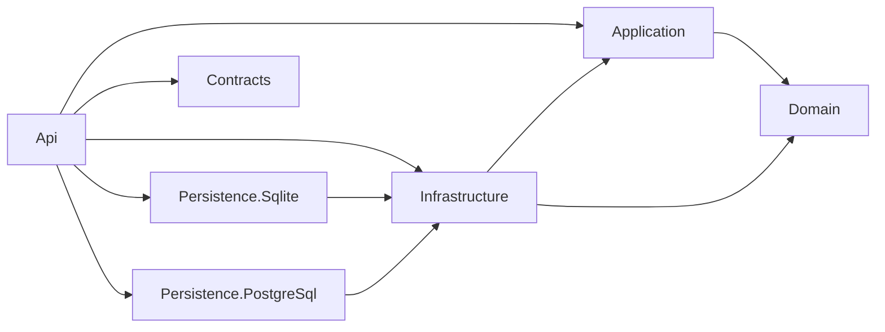

# Solution structure and dependency boundaries

This page describes the **implemented** Phase 1 solution. Direction comes from
[ADR-001/002/004](../ADR.md) and [Architecture §3 and §17.1](../ARCHITECTURE.md).

## Projects

| Project | Path | Responsibility today |
| --- | --- | --- |
| `Audorix.ChatX.Domain` | `src/Core/` | Entities and invariants. Currently the `Installations/Installation` record and `DomainRuleException`. |
| `Audorix.ChatX.Application` | `src/Core/` | Use cases and ports: `InstallationService`, `IInstallationStore`, `LocalizationSettings`. |
| `Audorix.ChatX.Contracts` | `src/Core/` | Wire DTOs: `/api/v1/meta` response, health report, stable `ErrorCodes`. |
| `Audorix.ChatX.Infrastructure` | `src/Infrastructure/` | Provider-neutral EF Core model (`ChatXDbContext`, mappings), the `IInstallationStore` adapter, database options validation, readiness health check, `DatabaseMigrator`, the `IDatabaseProvider` port for provider adapters. |
| `Audorix.ChatX.Persistence.Sqlite` | `src/Infrastructure/` | SQLite adapter, its migrations and model snapshot, design-time factory. |
| `Audorix.ChatX.Persistence.PostgreSql` | `src/Infrastructure/` | PostgreSQL (Npgsql) adapter, its migrations and model snapshot, design-time factory. |
| `Audorix.ChatX.Api` | `src/Api/` | Composition root, HTTP pipeline, health/OpenAPI endpoints, problem responses, localization resources, `migrate` command. |
| Test projects | `tests/` | `UnitTests`, `ArchitectureTests`, `IntegrationTests` (real SQLite/PostgreSQL). |

## Actual reference graph

- **Domain** and **Contracts** reference nothing (no projects, no packages).
- **Application** references Domain plus only `Microsoft.Extensions.DependencyInjection.Abstractions`
  and `Microsoft.Extensions.Options`. It does not yet reference Contracts because no use case
  returns a wire DTO; add that edge when one does.
- **Infrastructure** references EF Core *Relational* only. Neither SQLite nor Npgsql packages
  are visible to it.
- Each **persistence project** references Infrastructure and exactly one EF provider. They never
  reference each other.
- **Api** is the only project that sees every adapter; `Database:Provider` selects one at runtime.

The graph is enforced by `tests/Audorix.ChatX.ArchitectureTests`, which checks both the
declared `ProjectReference`/`PackageReference` items and the references compiled into each
assembly, plus that Contracts types expose only primitives, collections and other contracts.
Adding an edge requires updating that test and this page.

## Modules

Future modules (Identity, Users, Organizations, Contacts, Conversations, Messaging, Presence,
Notifications, Attachments, Widgets) will start as folders inside these projects, as
Architecture §3.1 recommends. Phase 1 creates only `Installations` and `Localization` folders
because only they have code; no empty module folders or projects were generated.

## Design choices recorded in Phase 1

| Choice | Reason |
| --- | --- |
| One `ChatXDbContext` in Infrastructure; migrations in each provider project via `MigrationsAssembly` | Shared logical model (ADR-004) with independent provider migrations and snapshots. |
| `IDatabaseProvider` port with two implementations | Lets Infrastructure validate and configure a provider without referencing provider packages. Not a generic repository. |
| Each persistence project is its own design-time startup project | `dotnet ef migrations add` for SQLite never needs PostgreSQL and vice versa; no database is opened. |
| `Installation` foundation record, single row enforced by a unique index + check constraint on a shadow `singleton` column | Proves migrations and CRUD on both providers without speculative chat, tenant or widget tables. Internal only: no endpoint reads or writes it. |
| Explicit snake_case table/column names | Identical, unquoted names on both providers. |
| `DateTimeOffset` for timestamps, always UTC | Maps to `timestamp with time zone` in PostgreSQL. SQLite stores it as text; it cannot be ordered server-side there, which matters for later message history design (see ADR-017/ADR-022). |
| `Guid.CreateVersion7` identifiers | GUID identifiers (ADR-017) that sort roughly by creation time. |
| `TimeProvider` instead of a custom `IClock` | Framework abstraction, overridable in tests. |
| `migrate` command on the API executable | Same image/binary applies migrations as a separate, explicit step. Normal startup never migrates and never calls `EnsureCreated`. |
| Vite proxy (dev) and nginx (Docker) for API access | Same-origin in both cases, so the API configures **no CORS at all**. |
| Microsoft.Testing.Platform runner (`global.json`) with xUnit v3 | Required by the xUnit v3 releases used on the .NET 10 SDK. |
