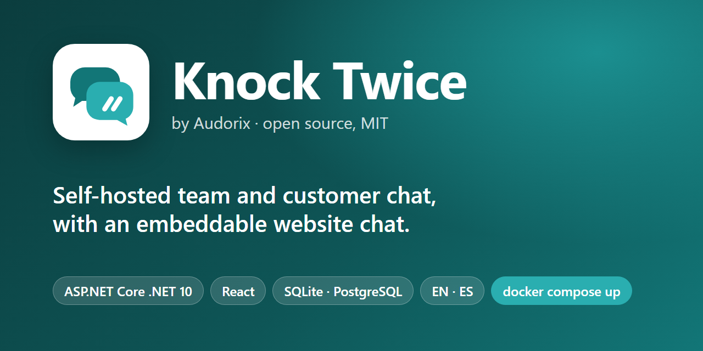

<p align="center">
  
</p>

# Docker development profiles

For a production server use [the Docker deployment guide](../deployment-docker.md) and
`docker/compose.production.yaml` instead (Production environment, no Mailpit, API not published,
web port bound to localhost behind HTTPS).

Two self-contained Compose files, each a separate Compose project with its own named volume:

| Profile | File | Project name | Database | Persistent volume |
| --- | --- | --- | --- | --- |
| SQLite | `docker/compose.sqlite.yaml` | `chatx-sqlite` | SQLite file `/app/data/chatx.db` | `chatx-sqlite_sqlite-data` |
| PostgreSQL | `docker/compose.postgres.yaml` | `chatx-postgres` | PostgreSQL 18 | `chatx-postgres_postgres-data` (database), `chatx-postgres_api-data` (setup settings file) |

Services in each profile:

- `migrate` — the API image running `migrate` once; exits when done.
- `api` — starts only after `migrate` succeeded. Published on `http://localhost:5080`.
- `web` — nginx serving the React build on `http://localhost:8080` and proxying `/api`,
  `/health`, `/openapi` and `/swagger` to `api` (same origin, so no CORS). Swagger UI:
  `http://localhost:8080/swagger` while `CHATX_ENVIRONMENT=Development`.
- `mailpit` — local SMTP server receiving all development email (confirmation and reset
  links). Inbox: `http://localhost:8025` (bound to 127.0.0.1). Messages are not persisted.
- `postgres` (PostgreSQL profile only) — not published to the host by default.

**First start: the setup wizard.** Open <http://localhost:8080>; the web app shows the setup
wizard. Its setup code is in the API log (see also
[Finding the setup code](../installation.md#finding-the-setup-code)):

```powershell
docker compose -f docker/compose.sqlite.yaml logs api
```

The database is fixed by the profile (environment variables), so the wizard shows it as locked.
Enter SMTP host `mailpit`, port `1025`, security "None" to deliver development email to Mailpit
(or choose Postmark), keep `http://localhost:8080` as the web address, and create the
administrator. The wizard's settings file is stored in the data volume
(`/app/data/chatx.settings.json`), so it survives container restarts and is deleted together with
the volume. The nginx `web` service also proxies the realtime hub `/hubs/` with WebSocket upgrade.

Requirements: Docker Engine with Compose v2. No registry account or cloud service is needed
beyond pulling public base images (`mcr.microsoft.com/dotnet/*`, `node`, `nginxinc/nginx-unprivileged`,
`postgres`, `axllent/mailpit`). The default captcha widget loads from Cloudflare.

Run every command from the repository root. Run only one profile at a time, or change
`CHATX_WEB_PORT`/`CHATX_API_PORT` in `docker/.env`, because both default to the same host ports.

## Environment file

```powershell
Copy-Item docker/.env.example docker/.env
```

Edit `docker/.env` (git-ignored). `CHATX_POSTGRES_PASSWORD` is required by the PostgreSQL
profile; pick any local value without `;` characters (it is embedded in a connection string).

## SQLite profile

```powershell
docker compose -f docker/compose.sqlite.yaml up --build -d
```

```powershell
docker compose -f docker/compose.sqlite.yaml ps
```

Open <http://localhost:8080>. Re-apply migrations explicitly at any time (idempotent):

```powershell
docker compose -f docker/compose.sqlite.yaml run --rm migrate
```

## PostgreSQL profile

```powershell
docker compose -f docker/compose.postgres.yaml up --build -d
```

```powershell
docker compose -f docker/compose.postgres.yaml run --rm migrate
```

## Logs

```powershell
docker compose -f docker/compose.sqlite.yaml logs -f api
```

## Normal shutdown (keeps data)

`down` removes containers and the network but **keeps named volumes**, so the database
survives and the next `up` reuses it:

```powershell
docker compose -f docker/compose.sqlite.yaml down
```

```powershell
docker compose -f docker/compose.postgres.yaml down
```

## Reset (DESTRUCTIVE — deletes development data)

`-v` deletes the profile's named volumes and every record in them, including the setup settings
file, so the next start shows the setup wizard again. Only the volumes of the named Compose
project are affected.

```powershell
docker compose -f docker/compose.sqlite.yaml down -v
```

```powershell
docker compose -f docker/compose.postgres.yaml down -v
```

## Notes

- The API containers run as the non-root `app` user. `ASPNETCORE_ENVIRONMENT` defaults to
  `Development` here so `/openapi/v1.json` is available; set `CHATX_ENVIRONMENT=Production` to
  check production behaviour.
- PostgreSQL is the production-oriented path; SQLite is the lightweight single-instance path.
  These files are development profiles: a production deployment should terminate TLS at a
  reverse proxy, supply secrets from a secret store, and run `migrate` as a controlled step.
- Attachments are stored in the data volume (`Storage__Local__Path=/app/data/attachments`); back
  the volume up with the database. For object storage set `Storage__Provider=S3` and the
  `Storage__S3__*` variables (secrets from the environment, never from compose files). nginx accepts
  request bodies up to 26 MB to match `Attachments:MaxFileSize`.
- No Redis, realtime backplane, ClamAV or object storage container is included; add a clamd
  service and `Scanning__Provider=ClamAv` to enable malware scanning.
- Website chat (Phase 10): nginx serves `/widget.js` (the loader other websites include) and
  `/embed.html`, the only page that may be framed. For each request it asks the API for the
  widget's frame policy (`auth_request` to `/api/v1/widget/{id}/frame-policy`) and sends
  `Content-Security-Policy: frame-ancestors` with that widget's allowed origins; every other page
  keeps `X-Frame-Options: DENY`. The official nginx images include the `auth_request` module.
- Behind this nginx the API sees nginx's address for every request, so per-address limits
  (sign-in attempts, anonymous website-chat sessions) are shared by all clients. These profiles
  also publish the API port directly, which is why `Network__TrustedProxies` is not set here; in a
  deployment where the API is reachable only through the proxy, set it to the proxy's network.
