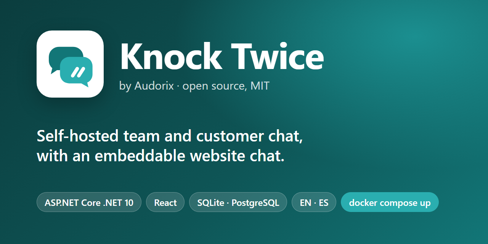

<p align="center">
  
</p>

# Quick start with Docker

Try Knock Twice on your own computer in a few minutes with the published Docker Hub images
([`ikemyle/knocktwice-api`](https://hub.docker.com/r/ikemyle/knocktwice-api) and
[`ikemyle/knocktwice-web`](https://hub.docker.com/r/ikemyle/knocktwice-web)). You need one file and
Docker; nothing is compiled, and there is no password or settings file to prepare.

This setup is for trying Knock Twice out: it uses SQLite and is reachable only from your own
computer. To run it on a server for other people, use the [Docker deployment guide](deployment-docker.md)
(PostgreSQL and HTTPS).

## 1. Install Docker

Install [Docker Desktop](https://www.docker.com/products/docker-desktop/) (Windows or Mac) and start
it. On Linux, Docker Engine with the Compose plugin works the same way.

## 2. Download the quick-start file

Save [`compose.quickstart.yaml`](https://raw.githubusercontent.com/Audorix/KnockTwice/master/docker/compose.quickstart.yaml)
into an empty folder, with the browser (right-click, *Save link as*) or from a terminal:

```powershell
Invoke-WebRequest https://raw.githubusercontent.com/Audorix/KnockTwice/master/docker/compose.quickstart.yaml -OutFile compose.quickstart.yaml
```

On Linux or Mac: `curl -fsSLO https://raw.githubusercontent.com/Audorix/KnockTwice/master/docker/compose.quickstart.yaml`.
If you cloned the repository, the file is already in `docker/`.

## 3. Start it

Starting a set of containers from a Compose file takes one command; Docker Desktop has no button
for it. Open a terminal in the folder with the file (in Docker Desktop: the **Terminal** button at
the bottom right, then `cd` to the folder) and run:

```powershell
docker compose -f compose.quickstart.yaml up -d
```

Docker downloads the images and starts four containers: `migrate` (prepares the database, then
stops), `api`, `web` and `mailpit` (catches the emails the app sends). In Docker Desktop they appear
under **Containers** as the group **knocktwice**; from now on you can start, stop and read logs
there.

Do not use the **Run** button on an image in Docker Desktop: it starts a single container, and
Knock Twice needs the containers above working together.

## 4. Run the setup wizard

Open <http://localhost:8080>. The wizard asks for a setup code: in Docker Desktop, open
**Containers > knocktwice > api > Logs** and look for *Knock Twice setup code*, or run:

```powershell
docker compose -f compose.quickstart.yaml logs api
```

Then:

- **Database:** already set (SQLite); click *Continue*.
- **Email:** choose *SMTP server*, host `mailpit`, port `1025`, security *None*, and any sender
  address. The emails arrive in the inbox at <http://localhost:8025>.
- **Administrator:** your name, email and a password.
- **Options:** keep the web address `http://localhost:8080`, and switch human verification *Off*
  (or enter Cloudflare Turnstile keys).

Click *Install*. The API restarts by itself; then sign in.

## If a port is already in use

The quick start uses two ports on your computer. If another program already uses one of them,
`up` fails with an error such as *port is already allocated* or *bind: address already in use*.
Choose other ports with these variables:

| Variable | Default | What it is |
| --- | --- | --- |
| `KNOCKTWICE_PORT` | `8080` | The Knock Twice web app |
| `KNOCKTWICE_MAIL_PORT` | `8025` | The Mailpit inbox, where you read the emails the app sends |

Set them in the same command that starts Knock Twice. In PowerShell:

```powershell
$env:KNOCKTWICE_MAIL_PORT = "8026"; docker compose -f compose.quickstart.yaml up -d
```

On Linux or Mac:

```sh
KNOCKTWICE_MAIL_PORT=8026 docker compose -f compose.quickstart.yaml up -d
```

To keep the choice, so you do not have to set it every time, put it in a file named `.env` next to
`compose.quickstart.yaml`. Docker Compose reads that file by itself on every start:

```text
KNOCKTWICE_PORT=8090
KNOCKTWICE_MAIL_PORT=8026
```

Good to know:

- **Email settings in the wizard stay the same:** host `mailpit`, port `1025`. That port is inside
  Docker's own network, so programs on your computer cannot block it. Only the inbox page moves, for
  example to <http://localhost:8026>.
- **If you change the web port**, open Knock Twice at the new address (for example
  <http://localhost:8090>) and enter that address as the **Web app address** in the wizard, so links
  in emails point to the right place.
- **Already running?** Stop it with `docker compose -f compose.quickstart.yaml down` (your data is
  kept), then start it again with the new port.
- **To see which program uses a port** on Windows, for example 8025:

  ```powershell
  Get-NetTCPConnection -LocalPort 8025 -State Listen | ForEach-Object { Get-Process -Id $_.OwningProcess }
  ```

## Stop, start again, remove

| Task | Command |
| --- | --- |
| Stop (keeps your data) | `docker compose -f compose.quickstart.yaml down` |
| Start again | `docker compose -f compose.quickstart.yaml up -d` |
| Remove everything, including all data | `docker compose -f compose.quickstart.yaml down -v` |

The data (database, uploaded files, settings) is kept in the Docker volume `knocktwice_data`.

Use a current Chrome, Edge or Firefox: sign-in cookies require HTTPS, which these browsers also
accept on `http://localhost`.
